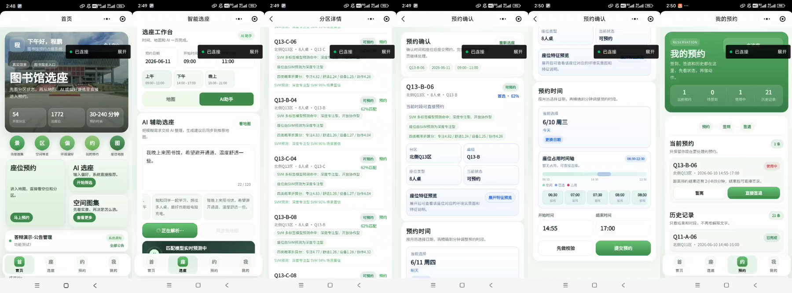

# Library Seat Reservation System

Bachelor thesis project (Jiangxi University of Science and Technology, 2026):
a seat reservation system for a university library, with a WeChat Mini Program
for readers, a Node.js backend, a MySQL database, a web admin dashboard and a
machine-learning based seat recommendation.

> The user interface is in Chinese, because the system was built for a Chinese university library.
> The thesis itself is in [`docs/thesis_zh.pdf`](docs/thesis_zh.pdf) (70 pages, in Chinese, with an English abstract).

## Demo

<p align="center">
  
</p>

The recording above plays at three times the normal speed. The full video (about 2 minutes,
recorded on a phone) is in [`docs/demo.mp4`](docs/demo.mp4).



## What it does

**Readers (WeChat Mini Program)**
- Browse zones and seats with their properties (window, power outlet, quiet, table size, …)
- See a seat's timeline for the day and reserve a time slot
- Check in (location-based), take a temporary leave, return and check out
- View reservations, notices and their credit score
- Describe what they need in natural language ("quiet seat with a power outlet for a long study session")
  and get ranked seat recommendations

**Administrators (web dashboard)**
- Dashboard with usage rate, reservations, check-in rate and no-shows
- Manage notices, seats, users and credit scores
- Configure reservation rules (opening hours, maximum duration, days in advance, leave limits, …)

## Architecture

```
WeChat Mini Program ─┐
                     ├── HTTP/JSON ──> Node.js server ──> MySQL
Web admin dashboard ─┘                     │
                                           └── Python (scikit-learn SVM) for recommendations
```

| Part | Technology | Folder |
|---|---|---|
| Reader app | WeChat Mini Program (WXML, WXSS, JavaScript) | `miniprogram/` |
| Backend | Node.js (built-in `http` module), `mysql2` | `server/` |
| Admin dashboard | HTML, CSS, JavaScript (no framework) | `admin-web/` |
| Database | MySQL 8, schema and seed data | `sql/` |
| Recommendation | Python, scikit-learn | `scripts/`, `data/` |
| Early web prototype | HTML, CSS, JavaScript | `prototype/` |

## Technical highlights

### Correct reservations under concurrent requests

Two readers may try to book the same seat for overlapping times at the same moment.
A booking therefore runs in one **database transaction** that takes two row locks in a
fixed order, first the reader, then the seat, and only then checks the rules:

1. Start a transaction at isolation level READ COMMITTED
2. Lock the reader's row and the seat's row (`SELECT … FOR UPDATE`)
3. Check the rules: seat available, limits of the reader, time conflicts of reader and seat
4. Insert the reservation and its 5-minute slots, then commit (or roll back on any error)

The seat row acts as the lock for all bookings of that seat: a second request waits until
the first one has committed, then sees its reservation and is rejected with a normal
"seat is taken" answer. In addition, every active reservation occupies one row per
5-minute slot in `seat_reservation_slot`, and a **unique key on (seat, date, slot)** makes
an overlapping reservation impossible at the level of the database, whatever the
application code does.

The first version of this transaction used locking reads on the reservation table instead.
It never double-booked a seat, but under parallel load most bookings failed with
deadlocks, even for different seats. [docs/database.md](docs/database.md) explains the
cause (gap locks), the new locking protocol, and the measurements:

| 200 bookings of 200 different seats, 8 in parallel | Before | After |
|---|---:|---:|
| failed bookings | 133 | 0 |

`npm run test:concurrency` checks the behaviour with 30 simultaneous readers against a
real MySQL database.

### Database design

The MySQL schema has 12 tables (`sql/001_schema.sql`): users, zones, seats, reservations
and their time slots, check-in and leave records, credit log, notices, admin and seat
status logs, and system configuration. Foreign keys keep the references consistent, unique
keys protect natural identifiers (student number, seat code, reservation number) and the
time slots of a seat, and composite indexes follow the main queries, for example
`(seat_id, reservation_date, start_time)` for the seat conflict check and
`(user_id, reservation_date, status)` for a reader's reservations.

To see how the queries behave on a table of realistic size, I filled the database with one
million synthetic reservations and looked at the query plans. The booking path was fine;
the statistics query of the admin dashboard read the whole table (about 300 ms) and got an
index on `reservation_date` (0.3 ms for one day, 25 ms for a week). Details and limits are
in [docs/database.md](docs/database.md).

### Rules checked in the backend

All business rules (time validity, opening hours, maximum duration of 240 minutes,
booking at most 3 days in advance, check-in window, temporary leave limits, blacklist)
are enforced on the server, not only in the user interface. The rules are stored in the
database and can be changed in the admin dashboard.

### Seat recommendation as multi-label classification

Seat recommendation is modelled as matching between a reader's requirement and a seat:

- 56 representative requirements × 1,772 seats → 99,232 candidate pairs,
  34,216 after filtering and class balancing
- 68 features per pair (seat environment, table group and zone statistics, preference matches, conflicts)
- 4 output labels: deep focus, comfortable long study, device work, open collaboration
- 7 classifiers compared (logistic regression, SVM, MLP, random forest, decision tree, k-NN, Gaussian naive Bayes)

| Model | Macro-F1 | Micro-F1 | Top-5 precision |
|---|---|---|---|
| SVM (selected) | 0.907 | 0.927 | 0.964 |

At runtime the server filters the seats that can actually be booked, builds the features
and calls the trained SVM; the final ranking combines model scores with explicit
preference matches and penalties for conflicts.

Three things to know about these numbers, described in
[docs/recommendation.md](docs/recommendation.md):

- **The labels are generated by rules, not by real readers.** The project has no usage
  data. The Macro-F1 says how well the SVM reproduces the rule-based labels on unseen
  requirements, not how satisfied readers are.
- **The reasons shown next to a seat are not a faithful explanation of the model.** I
  checked this with the exact feature contributions of the linear SVM: the features named
  in a reason carry about 3 % of the positive contribution to the score of a recommended
  seat. The model mostly relies on the rule scores it gets as input.
- **Latency.** The backend used to start a new Python process for every recommendation
  request. It now keeps one worker process with the model loaded. A request that scores
  all 1,772 seats went from about 3.1 s to about 1.25 s; scoring 20 seats takes 23 ms
  instead of 1.8 s. What remains is the feature construction, one seat at a time.

### Authentication

- Passwords are hashed with **scrypt** (Node.js `crypto`, random salt per user) and compared in constant time
- Login errors do not reveal whether the account or the password was wrong
- Sessions use HMAC-signed tokens; the signing secret comes from the environment (`AUTH_TOKEN_SECRET`)
- Admin endpoints require an admin token; readers cannot access `/api/admin/*`

## Running locally

Requirements: Node.js 18+, MySQL 8, Python 3 with the packages in `scripts/requirements.txt`
(only for recommendations), WeChat DevTools (only for the Mini Program).

```bash
# 1. Database
mysql -u root -p < sql/001_schema.sql
mysql -u root -p library_seat_reservation < sql/002_seed_config_and_demo.sql
mysql -u root -p library_seat_reservation < sql/003_seed_library_layout.sql
mysql -u root -p library_seat_reservation < sql/004_seed_final_demo_data.sql
mysql -u root -p library_seat_reservation < sql/006_backfill_reservation_slots.sql

# 2. Server
cd server
cp .env.example .env          # fill in DB_PASSWORD and AUTH_TOKEN_SECRET
npm install
npm run db:check              # checks the database connection
npm run set-password -- LIB001 <password>   # seeded admin accounts have no password yet
npm start                     # http://127.0.0.1:3000

# 3. Tests and measurements
npm run test:auth             # offline test of registration, login and password hashing
npm test                      # end-to-end smoke test (starts its own server on port 3101)
npm run test:concurrency      # many simultaneous bookings against MySQL
npm run bench:booking         # throughput and latency of the booking transaction

# 4. Recommendation model (optional)
cd ..
pip install -r scripts/requirements.txt
python scripts/build_matching_recommendation_pipeline.py   # builds the dataset and trains the models (about 5 minutes)
python scripts/explanation_faithfulness.py                 # analysis in docs/recommendation.md
cd server && npm run bench:inference                       # latency of a prediction
```

The trained model is not part of the repository; without step 4 the recommendation
endpoint has no model to call.

- Admin dashboard: open `http://127.0.0.1:3000/admin/` and log in with the admin account
- Mini Program: import the repository root in WeChat DevTools (`miniprogram/config/env.js`
  points to the local server by default)

## Project structure

```
miniprogram/     WeChat Mini Program (pages, services, utils)
server/          Node.js backend: HTTP routes, repositories (SQL), rules, authentication
admin-web/       admin dashboard
sql/             schema, seed data and migrations; sql/dev/ generates synthetic history
scripts/         dataset construction, model training and evaluation, runtime inference
data/            seat master data and recommendation runtime data
prototype/       first web prototype of the seat filter
docs/            thesis (PDF), demo video and screenshots, database.md, recommendation.md
```

## License

MIT
